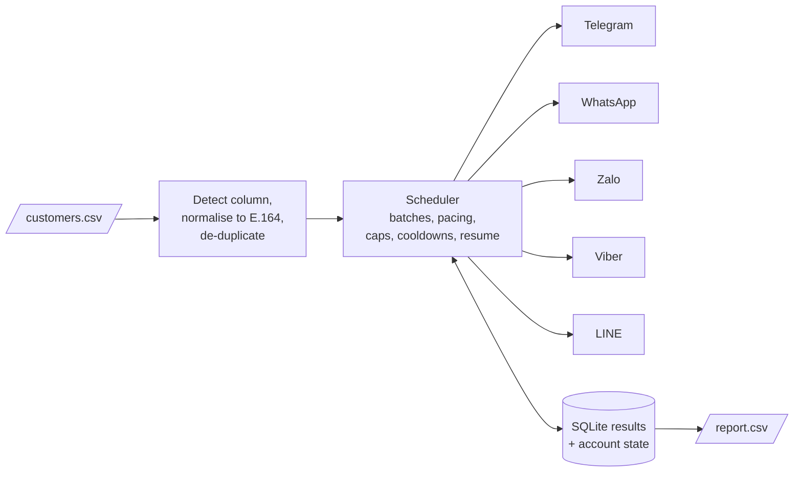

<div align="center">

<h1>
  <picture>
    <source media="(prefers-color-scheme: dark)" srcset="docs/assets/logo-horizontal-dark.svg">
    
  </picture>
</h1>

**Find out which messaging apps a phone number is registered on: Telegram, WhatsApp, Zalo, Viber, LINE.**
Local command-line tool. CSV in, CSV report out. No messages are ever sent.

[](https://github.com/QuocHuannn/phone-app-checker/actions/workflows/ci.yml)
[](LICENSE)
[](https://github.com/QuocHuannn/phone-app-checker/releases)
[](package.json)
[-lightgrey)](#quick-start)

</div>

phone-app-checker reads a CSV of phone numbers, normalises them to E.164, and asks each enabled messaging app whether the number has an account. It writes one `report.csv` row per number with one status column per app, and prints a summary. It runs entirely on your machine with accounts that **you** log in, paces its requests per account (batch sizes, daily caps, cooldowns), resumes after an interruption, and stores nothing about a person except the number, the status and the time.

> [!WARNING]
> **Responsible use: read before you run it.**
>
> - **Consent only.** Use it only for numbers of people who agreed to be contacted or checked. The tool cannot verify consent. Looking up whether a number has an account is processing of personal data: **check your local law** before you start (examples: Vietnam PDPL Law 91/2025/QH15, GDPR, Singapore and Malaysia PDPA, Indonesia PDP Law, Australia Privacy Act, New Zealand Privacy Act, Korea PIPA, US state privacy laws). This is not legal advice.
> - **Platform terms and bans.** The tool uses unofficial clients (or, for Viber, drives the real app). That very probably violates each platform's terms of service, and the accounts and SIMs you use **can be restricted or permanently banned**. Use dedicated, disposable accounts; never a personal or business-critical number.
> - **Not affiliated.** Independent project; not affiliated with, endorsed by or sponsored by Telegram, WhatsApp/Meta, Zalo/VNG, Viber/Rakuten or LINE/LY Corporation.
> - **No accuracy guarantee.** `not_found` can simply mean the person hides their number from search. LINE results are meaningful only in HK / JP / KR / TW / TH; Zalo is checked for Vietnam (+84) numbers only. Only part of this has been verified against the live platforms: see [Verification status](#verification-status).
>
> Full text: [docs/responsible-use.md](docs/responsible-use.md).

## Contents

[Features](#features) · [Quick start](#quick-start) · [Interactive menu](#interactive-menu) · [CLI reference](#cli-reference) · [Configuration](#configuration) · [How it works](#how-it-works) · [Per-app setup](#per-app-setup) · [Verification status](#verification-status) · [FAQ](#faq) · [Roadmap](#roadmap) · [Limitations](#limitations) · [Contributing](#contributing) · [Security](#security) · [License](#license)

## Features

| App | Method | Limits and caveats | Confidence |
| --- | --- | --- | --- |
| **Telegram** | A logged-in user account (MTProto via [mtcute](https://github.com/mtcute/mtcute)) imports numbers as temporary contacts and removes them after each batch. Needs your own free `api_id` / `api_hash`. | `not_found` can be a privacy setting. Throttling shows as `FLOOD_WAIT` / `retry_contacts`; `PEER_FLOOD` disables the account. Default cap 200 numbers/day/account. | Tests with doubles only; **not verified live** |
| **WhatsApp** | Linked device of a dedicated account ([Baileys](https://github.com/WhiskeySockets/Baileys) v7, a release candidate) asks WhatsApp's contact-discovery service which numbers are registered. Pairing code (recommended) or QR. | No setting hides a user from this lookup, so `not_found` is fairly reliable, but aggressive lookups get numbers banned. Default cap 300/day/account. | Linked with a pairing code and a few lookups answered correctly on a real account; **no 20-number known-answer trial yet** |
| **Zalo** | Logged-in session ([zca-js](https://github.com/RFS-ADRENO/zca-js)); finds a user by phone number. QR login in the terminal. | **Vietnam (+84) numbers only**; others are `skipped`. `not_found` covers "no account" and "hidden from phone search". Default cap 100/day/account. | QR login reached credentials-saved once on the maintainer's machine; **lookups not verified live** |
| **Viber** | No lookup API exists. Injects contacts on an Android emulator / rooted phone, lets Viber sync, reads which ones Viber marked registered from its own database using SQL **you** supply. | Slow (batches ~30 min apart), needs `adb`, root and a manual schema spike per Viber version. Disabled by default. | Tests against a simulated device only; **not verified live** |
| **LINE** | Logged-in secondary device ([linejs](https://github.com/evex-dev/linejs)); read-only phone lookup. QR or e-mail/password login. | Phone search is meaningful **only in HK / JP / KR / TW / TH**; elsewhere `not_found` is close to no information. Disabled by default. Default cap 50/day/account. | Tests with doubles only; **not verified live** |

Also: phone-column auto-detection (header names or content), delimiter and encoding sniffing (including Excel's UTF-16 export), de-duplication, result cache (`maxAgeDays`), several accounts per app, resumable runs (Ctrl-C finishes the batch and writes the report), masked phone numbers in logs, private file permissions, spreadsheet-formula neutralisation, an interactive menu in six languages, and an offline `doctor` self-check.

## Quick start

### Option A: macOS portable download (Apple Silicon, no Node.js needed)

Requires an Apple Silicon Mac, macOS 13.5 or newer. Download the archive and its checksum from the [latest release](https://github.com/QuocHuannn/phone-app-checker/releases/latest), then:

```sh
cd ~/Downloads
shasum -a 256 -c phone-app-checker-0.1.0-macos-arm64.tar.gz.sha256   # must print: ...tar.gz: OK
tar -xzf phone-app-checker-0.1.0-macos-arm64.tar.gz
bash phone-app-checker-0.1.0-macos-arm64/install.sh
```

Open a **new** Terminal window and run `phone-app-checker`. The archive carries its own official Node.js runtime and dependencies, installs under `~/Applications/phone-app-checker`, and keeps config, sessions and results in `~/Library/Application Support/phone-app-checker`. The archive is not signed or notarised; `install.sh` clears the download quarantine flag. Step-by-step guide for non-developers: [docs/install-macos.md](docs/install-macos.md) (Vietnamese: [docs/install-macos.vi.md](docs/install-macos.vi.md)). Uninstall: `~/Applications/phone-app-checker/current/uninstall.sh` (add `--purge-data` to delete data as well).

### Option B: from source (Node.js >= 22.18)

```sh
git clone https://github.com/QuocHuannn/phone-app-checker.git
cd phone-app-checker
npm ci                                                  # the LINE client comes from the JSR registry; .npmrc already points to it
cp checker.config.example.json checker.config.json      # optional; git-ignored
npm run cli -- doctor                                   # offline readiness check
npm run cli -- login whatsapp --account wa1 --method code --phone +84901234567
npm run cli -- check customers.csv --apps whatsapp --out report.csv
```

Replace `npm run cli --` with `phone-app-checker` if you installed the macOS archive or ran `npm link`. Run `phone-app-checker` with no arguments in a terminal for the [interactive menu](#interactive-menu).

### First run, safely

1. `doctor` (offline): runtime, config, data folder and each adapter's prerequisites. Green does **not** prove an account works.
2. Log in a **dedicated** account per app ([setup guides](#per-app-setup)).
3. Check a small file of ~20 numbers whose answers you already know. Compare. Only then run the real list.
4. Watch `phone-app-checker accounts` and raise `batchSize` / `dailyCap` slowly.

## Interactive menu

With no arguments in a terminal the tool opens a numbered, colour, arrow-key menu (plain numbered prompts when colours or raw mode are unavailable). Drag a CSV from Finder into the window to select it.

```text
╭─ Phone App Checker 0.1.0 ──────────────────────────────────────────
│ Accounts ready:
│ ⬜ telegram – · ✅ whatsapp 1 · ⬜ zalo – · ⬜ viber – · ⬜ line –
╰────────────────────────────────────────────────────────────────────
❯ 1 🔍 Check a CSV file
  2 🔑 Log in an app account
  3 👤 View logged-in accounts
  4 📄 Rebuild the latest report
  5 🩺 Check this Mac is ready (doctor)
  6 📖 Guide / warnings
  L 🌐 Language / Ngôn ngữ / Bahasa / 언어 / 语言: English
  0 🚪 Quit
↑↓ move · Enter select · q quit
```

The text above is an illustrative rendering of the layout; icons and spacing vary by terminal. English is the default; press `L` for Vietnamese, Bahasa Indonesia, Bahasa Melayu, Korean or Simplified Chinese (the last four are first-draft machine translations that need native review).

## CLI reference

```text
phone-app-checker [--config <path>] <command>

  login <app> [--account <name>] [--method qr|code] [--phone <number>]
      Log an account in (QR / pairing code / OTP); the session is stored under data/sessions.
  check <csv> [--out <file>] [--apps <list>] [--column <name|index>] [--max-age <days>]
              [--no-wait] [--force] [--progress auto|lines|off]
      Check every number and write the report. Resumable; fresh results are reused.
  report <csv> [--out <file>] [--apps <list>] [--column <name|index>] [--max-age <days>] [--force]
      Rebuild the report from stored results without any network access.
  accounts
      Per account: ready / cooling down until ... / DISABLED: reason, and usage today.
  account-reset <app> <account>
      Clear a cooldown or disabled flag after you fixed the cause.
  doctor
      Offline readiness check; exit 1 when something blocks use.
```

`--apps` takes `telegram,whatsapp,zalo,viber,line`. Exit codes: `0` success, `1` error or no valid numbers, `130` interrupted (the report is still written). `--help` on any command lists every option.

**Report.** One row per unique number: `input, e164, country, telegram, whatsapp, zalo, viber, line, last_checked_at`, then `<app>_checked_at` and `<app>_stale` per app.

| Status | Meaning |
| --- | --- |
| `yes` | The app answered that the number has an account (an observation at that time, not proof of identity or activity). |
| `not_found` | The app returned no account. **Not proof the person has none**: they may hide themselves from search. |
| `unknown` | Not checked yet, or the check failed or was throttled. Re-run `check`. |
| `skipped` | App disabled or not selected, or the number is outside the app's scope (Zalo: +84 only). |
| `invalid` | The cell is not a valid phone number for `defaultRegion`. |

An `INCOMPLETE` banner is printed last when some numbers have no fresh answer; run the same command again to continue.

## Configuration

`checker.config.json` is optional and every key has a default; unknown keys are rejected so typos fail loudly. [`checker.config.example.json`](checker.config.example.json) lists everything. Packaged macOS app: `~/Library/Application Support/phone-app-checker/checker.config.json`.

| Key | Default | Meaning |
| --- | --- | --- |
| `defaultRegion` | `"VN"` | ISO-3166 alpha-2 country used for numbers without a country code (`0901234567`). |
| `dataDir` | `"./data"` | Sessions (secrets) and the SQLite result database. |
| `maxAgeDays` | `30` | `yes` / `not_found` younger than this are reused, not re-checked. |
| `apps.<app>.enabled` | telegram, whatsapp, zalo: `true`; viber, line: `false` | Apps checked when `--apps` is not given. |
| `apps.<app>.batchSize` | 10 / 20 / 1 / 100 / 1 | Numbers per call (telegram / whatsapp / zalo / viber / line). |
| `apps.<app>.dailyCap` | 200 / 300 / 100 / 1000 / 50 | Numbers per account per local day. |
| `apps.<app>.minIntervalMs`, `jitterMs` | see example | Pause between batches on one account: `min + random(0..jitter)`. |
| `apps.<app>.rateLimitCooldownMs`, `errorCooldownMs` | 6-24 h / 10 min | Rest after a throttle / an unexpected error. |
| `apps.<app>.options` | | App-specific: Telegram `apiId` / `apiHash`; WhatsApp `pairingPhone`; LINE `loginMode`, `device`; Viber SQL queries and adb settings. |

Throughput is accounts x `dailyCap` per day: 10 000 numbers on one Telegram account at the default cap takes 50 days. The defaults are conservative guesses; platforms publish no limits. Details, data layout and secrets handling: [docs/reference.md](docs/reference.md).

## How it works



Each app has an adapter behind one small interface; an adapter logs in once (session stored privately under `data/sessions/<app>/<account>`) and then answers `yes` / `not_found` / `unknown` for a batch of numbers, or signals that the account is throttled or banned. The scheduler spreads batches over your accounts, enforces caps and cooldowns, commits every batch to SQLite and never lets a failed lookup overwrite an earlier answer. Read more in [docs/architecture.md](docs/architecture.md).

## Per-app setup

| App | Guide | Effort |
| --- | --- | --- |
| Telegram | [docs/telegram-setup.md](docs/telegram-setup.md) | minutes (needs `api_id` / `api_hash` from <https://my.telegram.org/apps>) |
| WhatsApp | [docs/whatsapp-setup.md](docs/whatsapp-setup.md) | minutes (phone at hand for the pairing code) |
| Zalo | [docs/zalo-setup.md](docs/zalo-setup.md) | minutes (Vietnam numbers only) |
| LINE | [docs/line-setup.md](docs/line-setup.md) | minutes (useful mainly in HK/JP/KR/TW/TH) |
| Viber | [docs/viber-setup.md](docs/viber-setup.md) | hours (Android emulator or rooted phone, `adb`, schema discovery) |

## Verification status

What has and has not been checked. Nothing here is a guarantee about live platforms.

| Area | Status |
| --- | --- |
| CSV parsing, phone normalisation, config validation, scheduler, SQLite store, report writer, run lock, file permissions, CLI end to end (with a test-only injected adapter) | Automated tests (`npm test`, over 1 500 tests); CI runs them on macOS and Ubuntu |
| Each adapter's error classification (yes / not_found / rate limit / ban) | Tested against **test doubles** of the third-party clients |
| macOS arm64 archive: install, `doctor`, offline `report`, reinstall, uninstall, minimum-OS load commands, no secrets or data shipped | `npm run release:verify` (checks V1-V19) on a development Mac. Not run on macOS 13.5 itself, on Intel Macs, or under Gatekeeper |
| **WhatsApp** against the live service | One real account linked with a pairing code; a handful of lookups returned the expected answers. QR linking on a real phone is unconfirmed (WhatsApp changed its flow in 2026-07; see the [guide](docs/whatsapp-setup.md)). No 20-number known-answer trial yet |
| **Zalo** against the live service | QR login completed once on the maintainer's machine; lookups not verified |
| **Telegram, Viber, LINE** against the live platforms | **Not verified** |
| Real rate limits, ban thresholds, sustainable throughput | **Unknown**; defaults are guesses |
| Menu translations other than English and Vietnamese | First-draft machine translation, not reviewed by native speakers |

Please run your own known-answer trial and open an issue with what you learn (without phone numbers or session data).

## FAQ

**Does it message or add the people it checks?** No. It sends no messages, calls, friend requests or invitations, and reads no names, avatars, ids, last-seen or profile data. Telegram's imported contacts are removed after each batch.

**Why did I get `not_found` for someone who uses the app?** Privacy settings can hide a user from phone search (Telegram, Zalo, LINE); Viber's answer depends on contact sync; a silent soft throttle can look like `not_found`. It is an observation, not proof.

**Can I use my personal number or my main account?** Please do not. Use dedicated, disposable accounts; they can be banned.

**Why does Telegram need my own `api_id`?** Telegram requires every program that logs in to carry keys that belong to its operator. The tool ships none and a shared pair would break Telegram's rules. Create yours at <https://my.telegram.org/apps>.

**Does it run on Windows or Linux?** The portable archive is macOS Apple Silicon only. From source it needs Node >= 22.18; CI runs the tests on Ubuntu. Windows is untested. Viber needs `adb` and an Android device or emulator.

**Where is my data?** In `dataDir` (default `./data`; packaged app: `~/Library/Application Support/phone-app-checker`): login sessions (treat like passwords), a SQLite database of checked numbers, and reports you asked for. It refuses cloud-synced folders such as iCloud Drive or Dropbox. Delete it when done.

**Why is it GPL-3.0-or-later?** `baileys` (MIT) depends on `libsignal` (GPL-3.0), and the macOS archive bundles both, so the project as a whole is distributed under GPL-3.0-or-later. See [THIRD_PARTY_LICENSES.md](THIRD_PARTY_LICENSES.md).

**Is this legal?** It depends on where you and the people you check are, what you do with the result, and whether they consented. See [docs/responsible-use.md](docs/responsible-use.md); this is not legal advice.

## Roadmap

Nothing below is promised; it is where help is most useful.

- Live pilots and known-answer trials for Telegram, Zalo, LINE and Viber, and a larger WhatsApp trial, with the results documented.
- Confirm WhatsApp QR linking on real phones after the 2026-07 flow change.
- Run the portable archive on macOS 13.5 and on a clean Mac under Gatekeeper; consider code signing and notarisation.
- Intel macOS and Linux builds of the portable archive.
- Native-speaker review of the Indonesian, Malay, Korean and Chinese menu texts.
- Tuning of default pacing from real-world reports.

## Limitations

- Depends on unofficial clients that follow protocols which can change without notice; lookups can break after any platform update. Baileys v7 is a release candidate.
- Platforms publish no limits; bans can happen at any time.
- Zalo: Vietnam only. LINE: a handful of regions. Viber: requires root and per-version SQL; no official API.
- Results are point-in-time observations; `not_found` is never proof of absence.
- The macOS archive is for Apple Silicon only and is neither code-signed nor notarised.

## Contributing

Issues and pull requests are welcome; see [CONTRIBUTING.md](CONTRIBUTING.md) and the [Code of Conduct](CODE_OF_CONDUCT.md). Do **not** paste phone numbers, session files or `api_hash` values into issues. Development: `npm ci`, `npm run typecheck`, `npm test`, `npm run smoke`; macOS release scripts: `npm run release:build`, `npm run release:verify`.

## Security

Report vulnerabilities privately through GitHub Security Advisories; see [SECURITY.md](SECURITY.md).

## License

Copyright (C) 2026 QuocHuannn and contributors. Licensed under the [GNU General Public License v3.0 or later](LICENSE) (`GPL-3.0-or-later`). Third-party components keep their own licences; see [THIRD_PARTY_LICENSES.md](THIRD_PARTY_LICENSES.md). The software is provided without warranty.
