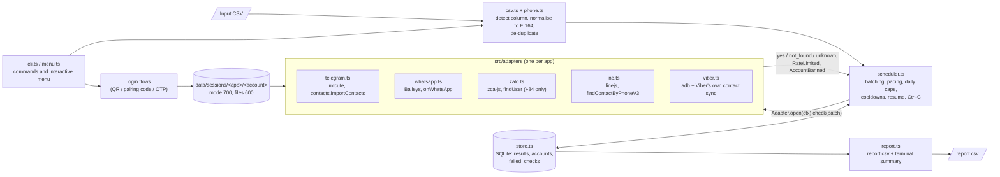

# Architecture

phone-app-checker is a single-process Node.js CLI written in TypeScript. Node >= 22.18 runs the `.ts` sources directly (type stripping), so there is no build step; `tsc --noEmit` is used only as a type check.

## Overview

## Components

| Path | Responsibility |
| --- | --- |
| `src/cli.ts`, `src/menu.ts`, `src/screens.ts`, `src/select.ts`, `src/ui.ts`, `src/progress.ts` | [commander](https://github.com/tj/commander.js) command tree, the interactive menu, terminal UI (colour, arrow-key selection, progress bar). Everything degrades to plain text when stdout is not a terminal. |
| `src/csv.ts`, `src/phone.ts` | Delimiter / encoding sniffing, phone column detection, normalisation to E.164 with [libphonenumber-js](https://gitlab.com/catamphetamine/libphonenumber-js), de-duplication. |
| `src/scheduler.ts` | Turns "numbers x apps x accounts" into batches. Enforces `batchSize`, `dailyCap`, `minIntervalMs` + jitter, rate-limit and error cooldowns, drops an account after repeated failures, parks a batch that keeps failing, resumes after an interruption, and finishes the current batch on Ctrl-C. |
| `src/store.ts` | SQLite (`node:sqlite`) with schema version 2: `results(e164, app, status, checked_at)`, `accounts` (cooldown, disabled reason, daily usage), `failed_checks`. Created with mode 600; symlinks and foreign owners are refused. |
| `src/adapters/*.ts` | One adapter per app behind the interface in `src/types.ts` (`Adapter.login`, `Adapter.open`, `Session.check`). Adapters are imported dynamically, so an unofficial client that breaks does not take the other apps or `report` down. Errors are classified as `RateLimited` (back off) or `AccountBanned` (needs a human); everything else is a temporary error. |
| `src/report.ts` | Builds `report.csv` (status and `*_checked_at` / `*_stale` columns per app) and the terminal summary; protects against overwriting the input or foreign files, and neutralises spreadsheet formulas. |
| `src/home.ts`, `src/paths.ts`, `src/lock.ts`, `src/private-file.ts` | App home and data directory resolution, refusal of unsafe or cloud-synced folders, the single-run lock and the lifecycle barrier that keeps install/uninstall from running next to a command, private file modes. |
| `src/doctor.ts` | Offline readiness checks (runtime, config, data dir, each adapter's prerequisites). It never contacts a platform. |
| `src/i18n/*` | Menu and login texts: English (source), Vietnamese, and first-draft Indonesian, Malay, Korean, Chinese. |
| `release/`, `scripts/build-release.sh`, `scripts/verify-release.sh` | macOS arm64 portable archive: pinned official Node.js, production `node_modules` built by that Node, `install.sh` / `uninstall.sh`, and a clean-room verification (V1-V19). |

## How each app is checked

| App | Mechanism | Sends anything to the person? |
| --- | --- | --- |
| Telegram | Logs in as a user account (MTProto, via mtcute) and imports the numbers as temporary contacts (`contacts.importContacts`); only the mapping `number -> exists` is used. Imported contacts are removed after each batch. The session database stores credentials only, not profiles. | No |
| WhatsApp | Linked device of a dedicated account (Baileys); asks WhatsApp's contact-discovery service (`onWhatsApp`) which numbers are registered. | No |
| Zalo | Logged-in session (zca-js); `findUser` by phone number. Error 216 is treated as `not_found` (no account **or** hidden from phone search). Vietnamese numbers only. | No |
| LINE | Logged-in secondary device (linejs); read-only `findContactByPhoneV3`. Meaningful only where LINE enables phone search. | No |
| Viber | No lookup API exists. Injects contacts on an Android emulator or rooted phone under a dedicated account, lets Viber sync them, reads which ones Viber marked as registered from Viber's own database with queries **you** supply, then deletes the contacts. | No |

## Design decisions

- **Fail closed.** Missing credentials, an unknown schema, an unsafe folder or a stale lock stop the run with a message instead of guessing.
- **Resumable by default.** Results are committed after every batch; a re-run asks only for what is missing or older than `maxAgeDays`. A later failed lookup never overwrites an earlier `yes` / `not_found`, and the report marks such cells stale.
- **Privacy by construction.** No names, avatars, ids or profile data are read or stored. Logs mask numbers (`+8490****567`), including inside URLs and paths.
- **Honest outputs.** Every report states per app how many numbers were needed, attempted and conclusive, and an `INCOMPLETE` banner is printed last when some are not.
- **No fake mode at runtime.** Tests substitute adapters only through the `loadAdapter` seam of `createProgram`, and adapter tests replace only the third-party client (or `adb`) with test doubles.

## Release pipeline

`scripts/build-release.sh` downloads the pinned Node.js tarball, verifies its SHA-256 and Apple signature, runs `npm ci --omit=dev` with that Node (deployment target macOS 13.5), then gates the stage: load gate (all five adapters import), architecture gate (every native file is arm64), minimum-OS gate (every Mach-O `minos` <= 13.5), `npm audit --omit=dev`, hygiene gate (no config, CSV, databases, maps). `scripts/verify-release.sh` unpacks the finished archive in a temporary `HOME` with an empty environment and runs install, `doctor`, an offline `report`, reinstall and uninstall (checks V1-V19). The archive ships `LICENSE`, `THIRD_PARTY_LICENSES.md` and the bundled Node.js licence.
